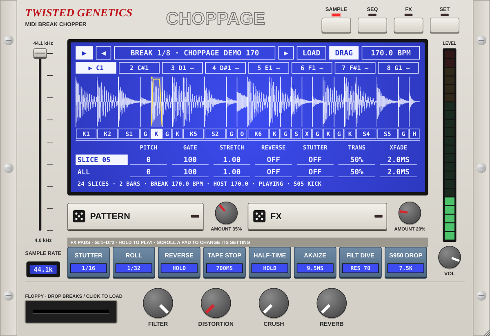
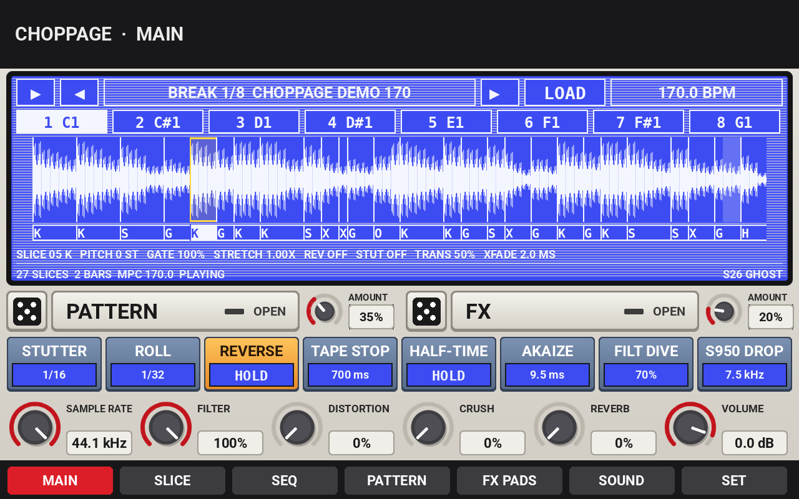

# CHOPPAGE

**Twisted Genetics' break chopper.** Eight breaks loaded, one plays at a time, each from its own key.
It slices them, badges every hit (kick / snare / ghost / hat / open hat), and rolls new patterns and FX
from the break's own hits. The sound goes through Akai-era sampler character and four post-FX knobs.
The screen layout follows BR3AK, drawn as an Akai S950 front panel.

AU · VST3 · Standalone (macOS, Apple Silicon + Intel). An MPC edition will follow, built the same way as
[Twisted-MPC-Breaks](https://github.com/TwistedGenetics/Twisted-MPC-Breaks).



## Install
Every green build of `main` becomes a **Release** with `CHOPPAGE-macOS.zip`. Unzip it and follow
`INSTALL.txt`: copy the `.component` / `.vst3` into your plug-in folders, clear quarantine, rescan.

## Keys (C1 = MIDI 36)
| Notes | MPC pads (chromatic from C1) | What |
|---|---|---|
| C1 – G1 | 1 – 8 (bottom two rows) | Break slots 1–8. One plays at a time |
| G#1 – D#2 | 9 – 16 (top two rows) | FX pads, held: STUTTER, ROLL, REVERSE, TAPE STOP, HALF-TIME, AKAIZE, FILT DIVE, S950 DROP |
| E2 – G3 | Pad bank B | Slices 1–16 of the playing break |
| G#3 – B4 | Pad bank C | Pattern memories 1–16 |

## The panel
- **Tabs**: **SAMPLE** · **SEQ** · **FX** · **SET** · **AKAI** · **DISK**
- **Status line**: the selected break's MUTE GROUP (GRP 1–4) and PLAYING / OTHER PLAYING (another break is running) / STOPPED. Hits show as K S GS H O P.
- **SAMPLE**: waveform with slice markers and badges (K1, S2, GS1, H3, O1, P1…).
  - Zoom: **ZOOM SLICE** (fills the view with the selected slice), **ZOOM +** / **ZOOM -**, **◀ ▶** to scroll, **ZOOM OUT ALL**. The mouse wheel zooms round the pointer; shift + wheel (or a sideways scroll) moves along. The view's times and zoom show beside the keys.
  - Click a slice to select it and hear it.
  - Drag a marker to move it; double-click to add one; right-click to mute, change the badge or delete the marker.
  - **SLICE / ALL** table: PITCH, GATE, STRETCH, REVERSE, STUTTER, TRANS, XFADE. Drag or scroll a value; double-click resets it.
- **SEQ**: PATTERN / ORIGINAL, 1 / 2 / 4 bars, history ◀ ▶, CLEAR, **RESET** (pattern back to the break as recorded and the FX lane emptied; undo with ◀).
  - Lanes KICK SNARE GHOST HAT OPEN PERC, then the FX row; each cell shows the slice number.
  - Click a cell to add or remove a hit, right-click to swap to another hit of the same type, shift-click to lock a step.
  - Per-step FX: click a step on the FX row (or any cell) to select it, then pick **STEP FX** OFF / STUTTER / REVERSE / STRETCH / TAPE STOP and **RATE** 1/8 – 1/64 underneath. Right-click an FX cell to cycle its rate.
  - 16 memories: click to recall, shift-click to save the pattern, alt-click to save the **original break** there. Right-click a memory for a menu (save pattern, save original, recall, clear).
- **FX**: filter LP/HP + res, distortion drive/tone, crush, reverb (mix, decay, damp, pre, width), echo, and every pad's setting.
- **SET**:
  - Tempo: SOURCE AUTO / ÷2 / ×2, SPEED, FIT (REPITCH / KEEP).
  - Trigger: SYNC / MIDI, break switching (RESTART / BAR SYNC / QUANT), velocity → start slice. A break plays only once its key (C1–G1) triggers it, timed to the host's tempo. The transport running doesn't start it on its own.
  - GATE: LATCH (until the same key again), HOLD (while held), ONE SHOT (one note plays the pattern to its end, then stops).
  - MUTE GROUP 1–4 per break: the same group cuts (the new break carries on from the same point in the bar with BAR SYNC), different groups play together.
  - **FX QUANTISE**: OFF, 1/32, 1/16, 1/8, 1/4, 1 BAR. A pad press waits for the next line of the grid, and letting go ends the effect on the next line (a quick tap plays one grid's worth).
  - Sound: CHARACTER (CLEAN, S950, SP-1200, MPC60, S1000, LO-FI), slicing TRANSIENTS / GRID and **SENS** (transient sensitivity: drag or scroll to re-slice, double-click = 62%).
  - Generate: STYLE, LAYERS, SWING.
  - LCD colour: BLUE (S950), GREEN, AMBER, WHITE.
  - Render: **AKAIZE THE BREAK** (settings on the AKAI tab).
- **AKAI**: the full Akaizer (as in Twisted Timestretch):
  - **SYNC** ON: stretch from the break's LOOP BPM (double-click = AUTO, the break's own tempo) to the host tempo, or TARGET with no host. SYNC OFF: **STRETCH** 25–2000 %.
  - **CYCLE LENGTH** 20–2000 samples, **CYCLE FREQ** linked to the length (41000 / length) unless **MANUAL**, **PITCH** ±24 semitones.
  - The render is 16-bit like the original Akaizer, written to `~/Music/CHOPPAGE/Renders/<name>_akaized.wav` (a new file each time) and loaded back in.
  - The same cycle settings drive the live **AKAIZE pad** and **slice STRETCH**.
  - **AKAIZE MODE**: STRETCH (slows down, as before) or **IN TIME**: the metallic Akai grain sound while the beat stays in time. **IN TIME PITCH** (±24 semitones) moves only the grains' pitch on the pad and slice STRETCH; the render keeps its length and uses its own PITCH.
- **DISK tab**: a break browser for `~/Music/CHOPPAGE/Breaks` (or any folder) listing BPM, bars, length and name. Click loads into the selected break; shift-click loads into the next empty one.
- **Long breaks**: a break longer than 2 bars uses 2 of its bars (the first 2 here; the MPC edition can pick which).
- **Presets**: SAVE PRESET / LOAD PRESET on the DISK tab save the whole setup (breaks, slices, patterns, memories, settings) as a `.chp` file in `~/Music/CHOPPAGE/Presets`. The files are the same as the MPC's (`VST2 Plugins/Content/Presets/CHOPPAGE`), so presets move between the two; breaks are found by path, or by file name in the Breaks folder.
- **PATTERN dice / FX dice** with AMOUNT. Every roll goes into the history.
- **SAMPLE RATE fader** 44.1 → 4.0 kHz · **FILTER · DISTORTION · CRUSH · REVERB** · **VOL**
- **LCD top bar**: ▶ (plays on CHOPPAGE's own clock when the host is stopped), break picker, LOAD, **DRAG** (drags the pattern out as a WAV), BPM.
- Drop WAV / AIFF / FLAC / MP3 or **REX** (.rx2 / .rex from ReCycle) files anywhere on the panel. Several files fill consecutive slots. A REX loop comes in with ReCycle's own slices and its tempo; RESLICE finds new ones.

Saved with the project: breaks (by path), slices, badges, slice settings, pattern, FX lane and memories.

## MPC edition
The desktop's main screen on the MPC's touchscreen: the S950 LCD with the waveform and slice markers, the PATTERN / FX dice, the 8 FX pads and the FILTER / DISTORTION / CRUSH / REVERB knobs, plus the BR3AK SEQ grid. Pads 1–8 play the breaks (every screen follows) and pads 9–16 hold the FX. Install and pages: [choppage-mpc/README.md](choppage-mpc/README.md). It comes as `choppage-*-mpc.zip` on each release (untested on hardware).




## Layout

| Folder | What |
|---|---|
| `choppage-core/` | The whole instrument in plain C++17, no JUCE: analysis, generators, playback engine, FX, the break session (slots, history, memories, browser, Akaize render, state). Shared by every edition. |
| `choppage-desktop/` | The JUCE AU / VST3 / Standalone wrapper and the S950 panel. |
| `choppage-mpc/` | The MPC standalone edition (official inMusic MPC Plugin SDK). |
| `tests/test_core.cpp` | Core tests, no JUCE needed. |

## Build
Builds run on GitHub Actions: core tests, macOS (universal AU + VST3 + app, auval, pluginval, host round trip) and Linux (VST3 + tests).
To build locally:

```bash
cmake -B build -S . -DCMAKE_BUILD_TYPE=Release
cmake --build build --config Release -j
./build/ChoppageTests_artefacts/Release/ChoppageTests                         # headless tests
./build/ChoppageTests_artefacts/Release/ChoppageTests --snapshot ui.png 1     # render a tab (0-4) to PNG
./build/test_core                                                             # core tests
# core only (no JUCE): cmake -B build -S . -DCHOP_BUILD_DESKTOP=OFF
```

What came from Twisted Breaks and Twisted Timestretch: [docs/REUSE.md](docs/REUSE.md).

## Transient detection (0.15)
Slicing finds hits with a rebuilt detector: a 24-band log spectrogram every 2.9 ms, SuperFlux in three groups (lows for kicks, mids, highs for snares and hats) plus a 6 ms burst detector for ghost notes and hats, each normalised by its own big hits; every hit is then placed on the sample it starts on and checked to be a real rise, starting on the zero crossing just before it (within 0.3 ms). Flams count as one hit.

On a test bench of 60 breaks with known hit starts (humanised, flams, ghost notes, room, noise, half of them low-passed and 12-bit): F-measure 0.90 -> 0.94, and the median distance from each slice start to the real hit start 0.98 ms -> 0.07 ms (97% within 1 ms, was 51%). SENSITIVITY works as before (higher = more slices; the default 0.62 is the bench's best). **+ ADD** splits a slice at the strongest hit this detector finds inside it.
