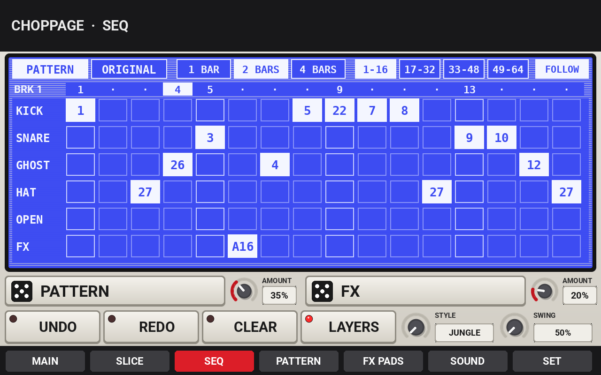

# CHOPPAGE

**Twisted Genetics' break chopper.** Eight breaks loaded, one plays at a time, each from its own key.
It slices them, badges every hit (kick / snare / ghost / hat / open hat), and rolls new patterns and FX
from the break's own hits. The sound goes through Akai-era sampler character and four post-FX knobs.
The screen layout follows BR3AK, drawn as an Akai S950 front panel.

AU · VST3 · Standalone (macOS, Apple Silicon + Intel). An MPC edition will follow, built the same way as
[Twisted-MPC-Breaks](https://github.com/TwistedGenetics/Twisted-MPC-Breaks).


## Install
Every green build of `main` becomes a **Release** with `CHOPPAGE-macOS.zip`. Unzip it and follow
`INSTALL.txt`: copy the `.component` / `.vst3` into your plug-in folders, clear quarantine, rescan.

## Keys (C1 = MIDI 36)
| Notes | MPC pads (chromatic from C1) | What |
|---|---|---|
| C1 – G1 | 1 – 8 (bottom two rows) | Break slots 1–8. One plays at a time |
| G#1 – D#2 | 9 – 16 (top two rows) | FX pads, held: STUTTER, ROLL, REVERSE, TAPE STOP, HALF-TIME, AKAIZE, FILT DIVE, S950 DROP |
| E2 – G3 | Pad bank B | Slices 1–16 of the playing break |
| G#3 – B4 | Pad bank C | Pattern memories 1–16 |

## The panel
- **Tabs** (the four S950 keys): **SAMPLE** · **SEQ** · **FX** · **SET**
- **SAMPLE**: waveform with slice markers and badges (K1, S2, G1, H3, O1…).
  - Click a slice to select it and hear it.
  - Drag a marker to move it; double-click to add one; right-click to mute, change the badge or delete the marker.
  - **SLICE / ALL** table: PITCH, GATE, STRETCH, REVERSE, STUTTER, TRANS, XFADE. Drag or scroll a value; double-click resets it.
- **SEQ**: PATTERN / ORIGINAL, 1 / 2 / 4 bars, history ◀ ▶, CLEAR.
  - Lanes KICK SNARE GHOST HAT OPEN FX; each cell shows the slice number.
  - Click a cell to add or remove a hit, right-click to swap to another hit of the same type, shift-click to lock a step.
  - FX cells: click to add or remove, right-click to change the rate (8 / 16 / 32 / 64).
  - 16 memories: click to recall, shift-click to save.
- **FX**: filter LP/HP + res, distortion drive/tone, crush, reverb (mix, decay, damp, pre, width), echo, and every pad's setting.
- **SET**:
  - Tempo: SOURCE AUTO / ÷2 / ×2, SPEED, FIT (REPITCH / KEEP).
  - Trigger: SYNC / MIDI, break switching (RESTART / BAR SYNC / QUANT), GATE LATCH / HOLD, velocity → start slice.
  - Sound: CHARACTER (CLEAN, S950, SP-1200, MPC60, S1000, LO-FI), slicing TRANSIENTS / GRID.
  - Generate: STYLE, LAYERS, SWING.
  - LCD colour: BLUE (S950), GREEN, AMBER, WHITE.
  - Render: **AKAIZE TO HOST BPM** writes the selected break, cyclic-stretched to the host tempo the Akaizer way, to `~/Music/CHOPPAGE/Renders` and loads it back in.
- **DISK tab**: a break browser for `~/Music/CHOPPAGE/Breaks` (or any folder) listing BPM, bars, length and name. Click loads into the selected break; shift-click loads into the next empty one.
- **PATTERN dice / FX dice** with AMOUNT. Every roll goes into the history.
- **SAMPLE RATE fader** 44.1 → 4.0 kHz · **FILTER · DISTORTION · CRUSH · REVERB** · **VOL**
- **LCD top bar**: ▶ (plays on CHOPPAGE's own clock when the host is stopped), break picker, LOAD, **DRAG** (drags the pattern out as a WAV), BPM.
- Drop WAV / AIFF / FLAC files anywhere on the panel. Several files fill consecutive slots.

Saved with the project: breaks (by path), slices, badges, slice settings, pattern, FX lane and memories.

## MPC edition
The desktop's main screen on the MPC's touchscreen: the S950 LCD with the waveform and slice markers, the PATTERN / FX dice, the 8 FX pads and the FILTER / DISTORTION / CRUSH / REVERB knobs, plus the BR3AK SEQ grid. Pads 1–8 play the breaks (every screen follows) and pads 9–16 hold the FX. Install and pages: [choppage-mpc/README.md](choppage-mpc/README.md). It comes as `choppage-*-mpc.zip` on each release (untested on hardware).




## Layout

| Folder | What |
|---|---|
| `choppage-core/` | The whole instrument in plain C++17, no JUCE: analysis, generators, playback engine, FX, the break session (slots, history, memories, browser, Akaize render, state). Shared by every edition. |
| `choppage-desktop/` | The JUCE AU / VST3 / Standalone wrapper and the S950 panel. |
| `choppage-mpc/` | The MPC standalone edition (official inMusic MPC Plugin SDK). |
| `tests/test_core.cpp` | Core tests, no JUCE needed. |

## Build
Builds run on GitHub Actions: core tests, macOS (universal AU + VST3 + app, auval, pluginval, host round trip) and Linux (VST3 + tests).
To build locally:

```bash
cmake -B build -S . -DCMAKE_BUILD_TYPE=Release
cmake --build build --config Release -j
./build/ChoppageTests_artefacts/Release/ChoppageTests                         # headless tests
./build/ChoppageTests_artefacts/Release/ChoppageTests --snapshot ui.png 1     # render a tab (0-4) to PNG
./build/test_core                                                             # core tests
# core only (no JUCE): cmake -B build -S . -DCHOP_BUILD_DESKTOP=OFF
```

What came from Twisted Breaks and Twisted Timestretch: [docs/REUSE.md](docs/REUSE.md).
