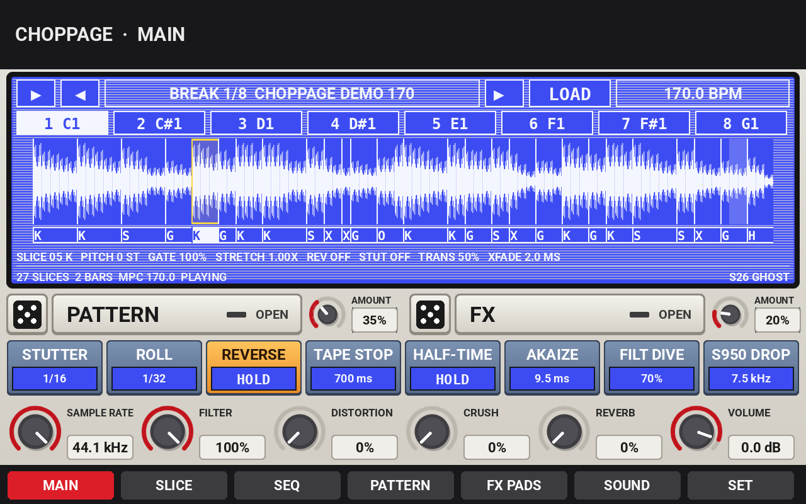

# CHOPPAGE for MPC

CHOPPAGE as a plugin on standalone Akai MPCs (MPC OS 3.10.1 or later). The folder carries both builds: 32-bit (Gen 1) and 64-bit (Gen 2); the MPC picks the right one.
It runs the same engine as the desktop AU / VST3, laid out as an Akai S950 front panel. **This edition is untested on hardware.**

## Install
1. Unzip and copy the `Twisted Genetics - VST - CHOPPAGE` folder into `VST2 Plugins` on an MPC drive (SD card, SSD or USB).
2. On the MPC, go to Preferences > Enhancements (Beta) and turn on **Enable Enhancements** and **External Plugin Support**, then restart.
3. Put your breaks (WAV or AIFF) in the plugin's `Content/Breaks` folder. A tempo in the file name is read: `amen_170.wav` = 170 BPM.
4. Make a plugin program with CHOPPAGE (it's under External Plugins).

## Pads
| Pads | Notes (default) | What |
|---|---|---|
| 1–8 (bottom two rows) | C1–G1 (36–43) | The 8 breaks. Hit one to switch to it; it plays locked to the MPC's tempo, and **every screen changes to that break**: the LCD, the waveform and slices, the SEQ grid, the slice settings |
| 9–16 (top two rows) | G#1–D#2 (44–51) | Hold FX: STUTTER, ROLL, REVERSE, TAPE STOP, HALF-TIME, AKAIZE, FILTER DIVE, S950 DROP |

If the program's pads send other notes, set **SET > PAD NOTES** to 37 (the MPC's default) or 48. Slices 1–16 of the playing break are on E2–G3, and pattern memories are on G#3–B4. These are the same as the desktop edition.

## Screens (the function keys under the MPC's screen)
Double-tap a knob for a big knob overlay. The Q-Links follow each screen, in rows of four.

**MAIN** is the desktop's main screen in the BR3AK arrangement. The S950 LCD has:
- ▶ (CHOPPAGE's own clock while the MPC is stopped), ◀ BREAK NAME ▶, LOAD and the tempo.
- The 8 break keys.
- The break's **waveform with its slice markers** (the selected slice in a yellow box, the slice playing now lit up) and the hit letter (K S G H O X) of every slice. Tap the waveform to pick and hear a slice.
- The selected slice's settings and the status line.

Under the LCD:
- **PATTERN** and **FX** bars. The dice square rolls; tap the bar to open that section, and tap it again to come back.
- The 8 FX pads, with their settings.
- FILTER, DISTORTION, CRUSH and REVERB, with SAMPLE RATE and VOLUME either side.

The sections:
- **PATTERN** turns the LCD into the SEQ grid (below), with LENGTH, STEPS SHOWN, FOLLOW, ORIGINAL, CLEAR, STYLE, SWING, MEMORY, SAVE, RECALL, UNDO and REDO underneath.
- **FX** puts each pad's setting knob under it.
- **LOAD** opens the DISK section: the files in `Content/Breaks` with their tempo (tap one), BROWSE, LOAD, DEMO BREAK and AKAIZE TO MPC BPM.

**SLICE / CHOP** (press SLICE again for CHOP): the waveform at the top, with ZOOM ALL or ZOOM SLICE. The **slice markers move as you edit them** with MOVE MARKER, NUDGE < >, ADD (split) and DELETE (join).
- SLICE has PITCH, GATE, STRETCH, TRANSIENT, REVERSE, STUTTER, XFADE and MUTE.
- CHOP has EDIT ALL SLICES, HIT (correct a hit letter), SLICING (TRANSIENTS / GRID), SENSITIVITY, GRID and RESLICE.

**SEQ** is the BR3AK pattern editor: a row each for KICK, SNARE, GHOST, HAT and OPEN, plus the FX lane, over 16 steps. A hit shows the number of the slice it plays.
- Tap a cell to put a hit of that kind there, or take it off.
- Tap the FX lane to step through STUTTER, REVERSE, STRETCH, TAPE STOP and off.
- Above the grid: PATTERN / ORIGINAL, LENGTH, STEPS (1-16 to 49-64) and FOLLOW, which keeps the playing steps on screen.
- The 16 Q-Links set the slice of the 16 steps shown.

**PATTERN, FX PADS, SOUND / SPACE, SET**: everything else, in rows of four, including the LCD colour (BLUE, GREEN, AMBER, WHITE) and PAD NOTES.

**Hits are found automatically:** when a break loads, CHOPPAGE slices it and works out what each slice is (kick, snare, ghost, hat, open hat or other), on the MPC just as on the desktop. The SEQ lanes and the dice use these. If one is wrong, fix it with HIT on the CHOP screen.

## What the MPC can't do
- **Coarser waveform:** MPC plugin screens have no drawing area, so the waveform is made of 84 picture columns the plugin sets (the approach Twisted MPC Breaks uses). It's less detailed than the desktop's.
- **No pad colours:** plugins can't light the MPC's pads.
- **Content folder only:** the plugin can only read files in its own `Content` folder.

## Build
Builds run on GitHub Actions: `choppage-mpc/build.sh` uses the official [MPC Plugin SDK](https://github.com/inmusic-software/mpc-plugin-builder-sdk) (submodule `external/mpc-plugin-builder-sdk`) and zig to cross-compile arm32 + arm64. Each build is checked with the SDK's host simulator.

| File | What |
|---|---|
| `src/ChoppageMpc.cpp` | The whole MPC-specific layer: `mpc::Plugin` adapter |
| `app/ChoppageMpcApp.cpp`, `include/` | Platform-independent app: parameter table, mirrors, readouts, worker (tested on desktop by `tests/test_mpc_app.cpp`) |
| `tools/make_skin.py` | Generates `skins/` (TUI.json, Q-Links.json, PNGs) from `tools/params.json` (`test_mpc_app --dump`), and checks the hardware rules (no label over a touch area, focus frame first) |
| `tools/preview_skin.py` | Draws the screens from the generated TUI.json with real values (`test_mpc_app --state`), to check a layout without an MPC |
| `tools/sync_core.sh` | One `src/core_*.cpp` wrapper per core source |
